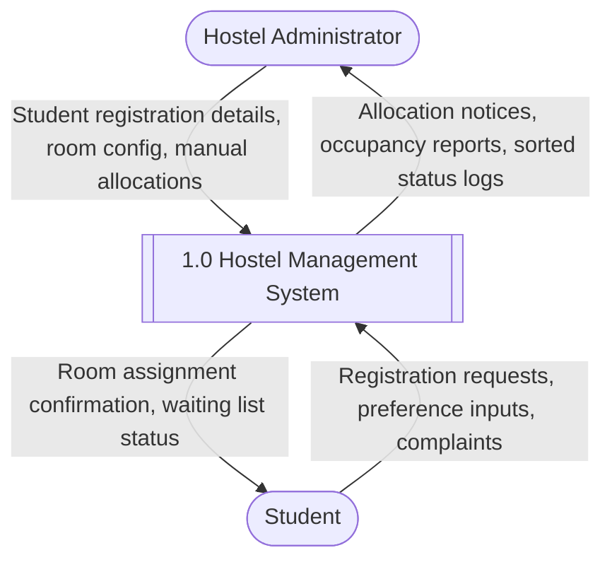

# Hostel Management System - Data Flow Diagrams (DFD)

This document formally specifies the complete Data Flow Architecture (Level 0, Level 1, and Level 2) for the Hostel Management System, aligning directly with the core DSA implementations.

---

## 1. Level 0 DFD (Context Diagram)

The Level 0 context diagram represents the overall system boundary, external actors, and high-level data flows.



```
+-----------------------------------+
|      Hostel Administrator         |
+-----------------------------------+
       |                       ^
       | Student Data,         | Status Reports,
       | Allocations           | Allocations
       V                       |
+-----------------------------------+
| 1.0 Hostel Management System      |
|    (Main Process Controller)      |
+-----------------------------------+
       ^                       |
       | Requests,             | Room Allotment,
       | Complaints            | Waiting Status
       |                       V
+-----------------------------------+
|             Student               |
+-----------------------------------+
```

---

## 2. Level 1 DFD (Decomposition into Sub-Processes)

Decomposes the main process into core functional processes and maps them to custom Data Structures and Stores:

```mermaid
flowchart TD
    Admin([Hostel Administrator])

    subgraph Core_Processes
        P1["1.0 Main System Controller"]
        P2["2.0 Student Registration & Priority Calc"]
        P3["3.0 Room Allocation & Availability Manager"]
        P4["4.0 View Reports & Analytics"]
        P5["Extra: Vacate & Auto-Reallocate"]
        P6["Extra: Undo/Redo Engine"]
    end

    subgraph Data_Stores
        DS_Students[("Student Records\n(Vector + Hash Index O(1))")]
        DS_PriorityQ[("Priority Waiting List\n(Binary Max-Heap)")]
        DS_NormalQ[("Normal Waiting List\n(Circular FIFO Queue)")]
        DS_Rooms[("Room / Allocation Store\n(HashTable + Vector)")]
        DS_Allocated[("Allocated Students DB\n(Doubly Linked List)")]
        DS_Master[("Master Status DB\n(WAITING/ALLOCATED/VACATED)")]
        DS_Stacks[("Transaction History\n(Two LIFO Stacks)")]
    end

    Admin -->|Input Student Details| P1
    P1 --> P2
    P2 -->|Save Profile| DS_Students
    P2 -->|Score >= 50.0| DS_PriorityQ
    P2 -->|Score < 50.0| DS_NormalQ
    P2 -->|Init Status WAITING| DS_Master

    P3 -->|Pop Highest Priority First| DS_PriorityQ
    P3 -->|Dequeue FIFO when Priority empty| DS_NormalQ
    P3 -->|Query Availability & Beds| DS_Rooms
    P3 -->|Increment Occupancy| DS_Rooms
    P3 -->|Insert Node| DS_Allocated
    P3 -->|Update ALLOCATED| DS_Master

    P5 -->|Vacate Room & Free Bed| DS_Rooms
    P5 -->|Remove Node O(1)| DS_Allocated
    P5 -->|Auto-Allocate Next Waiting| DS_PriorityQ
    P5 -->|Update Master Status| DS_Master

    P1 -->|Query Filter & Sort| P4
    P4 -->|QuickSort / MergeSort / HeapSort| DS_Students
    P4 -->|Report Output| Admin

    P1 -->|Execute Mutation| P6
    P6 -->|Push Action Command| DS_Stacks
    P6 -->|Undo/Redo State Rollback| DS_Master
```

---

## 3. Level 2 DFD: Process 2.0 (Student Registration)

Focuses on input validation, duplicate elimination via Bloom Filter and Hash Table, priority score evaluation, and waiting list routing:

```
[Student Details Input]
         │
         ▼
┌──────────────────────────────┐
│ 2.1 Input Validation         │ (Check non-empty fields, valid age 15-35, CGPA 0-10)
└────────┬─────────────────────┘
         │
         ▼
┌──────────────────────────────┐
│ 2.2 Duplicate Check          │
│ - Bloom Filter (Email/Phone) │ ──> [Reject if already exists]
│ - Hash Index O(1) by ID      │
└────────┬─────────────────────┘
         │
         ▼
┌──────────────────────────────┐
│ 2.3 Priority Score Engine    │
│ Score = (Year × 25) +        │
│         (CGPA × 5) +         │
│         (Distance × 0.02) +  │
│         SpecialBonus(15)     │
└────────┬─────────────────────┘
         │
         ├────────────────────────────────────────┐
         │ Score >= 50.0                          │ Score < 50.0
         ▼                                        ▼
┌──────────────────────────────┐       ┌──────────────────────────────┐
│ 2.4 Insert into Max-Heap     │       │ 2.5 Enqueue to Circular Ring │
│ Priority Waiting List        │       │ Normal FIFO Waiting List     │
└────────┬─────────────────────┘       └────────┬─────────────────────┘
         │                                      │
         └──────────────────┬───────────────────┘
                            ▼
                 ┌──────────────────────┐
                 │ Update Master Status │
                 │ Status = WAITING     │
                 └──────────────────────┘
```

---

## 4. Level 2 DFD: Process 3.0 (Room Allocation & Availability Manager)

Demonstrates strict Priority-First scheduling, Room store verification, Doubly Linked List append, and Full Room retention:

```
[Allocation Trigger]
         │
         ▼
┌──────────────────────────────────────┐
│ 3.1 Check Priority Queue             │
│ Is Binary Max-Heap Empty?            │
└───────┬──────────────────────┬───────┘
        │ No (Top item)        │ Yes
        ▼                      ▼
┌────────────────────┐ ┌──────────────────────────────────────┐
│ Pick Highest Score │ │ 3.2 Check Normal Queue (Circular FIFO│
└───────┬────────────┘ └───────┬──────────────────────────────┘
        │                      │
        └──────────┬───────────┘
                   ▼
┌──────────────────────────────────────┐
│ 3.3 Room Availability Check          │
│ Search Room Map for matching gender, │
│ capacity > occupied, and status      │
└───────┬──────────────────────┬───────┘
        │ Room Available       │ All Rooms Full
        ▼                      ▼
┌──────────────────────────┐ ┌──────────────────────────┐
│ Allocate Bed:            │ │ Student remains in       │
│ - Room.occupiedCount++   │ │ Waiting Queue!           │
│ - Append Allocation to   │ │ Error message:           │
│   Doubly Linked List     │ │ "All rooms full"         │
│ - Student.status =       │ └──────────────────────────┘
│   ALLOCATED              │
│ - Push AllocateCommand   │
│   to Undo Stack          │
└──────────────────────────┘
```

---

## 5. Level 2 DFD: Extra Flow - Vacate & Immediate Auto-Reallocation

Demonstrates the real-time bed reallocation cycle:

```
[Admin Request: Vacate Student X]
         │
         ▼
┌──────────────────────────────────────┐
│ 5.1 Locate Student & Room            │
│ Verify Status == ALLOCATED           │
└────────┬─────────────────────────────┘
         │
         ▼
┌──────────────────────────────────────┐
│ 5.2 Execute Vacation                 │
│ - Room.occupiedCount--               │
│ - Room.status = AVAILABLE            │
│ - Student.status = VACATED           │
│ - DoublyLinkedList.removeNode(X) O(1)│
└────────┬─────────────────────────────┘
         │
         ▼
┌──────────────────────────────────────┐
│ 5.3 AUTO-REALLOCATION TRIGGER        │
│ Does newly freed room have space?    │
└────────┬─────────────────────────────┘
         │
         ├────────────────────────────────────────┐
         │ If Priority Queue not empty            │ If Priority empty but Normal not empty
         ▼                                        ▼
┌──────────────────────────────────────┐ ┌──────────────────────────────────────┐
│ Pop top student from Max-Heap        │ │ Dequeue front student from CircQueue │
│ Allocate freed room immediately!     │ │ Allocate freed room immediately!     │
└────────┬─────────────────────────────┘ └────────┬─────────────────────────────┘
         │                                        │
         └──────────────────┬─────────────────────┘
                            ▼
                 ┌──────────────────────┐
                 │ Zero Bed Downtime    │
                 │ Record in Undo Stack │
                 └──────────────────────┘
```
